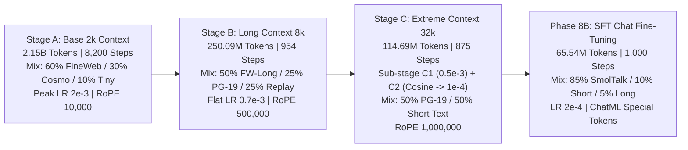

# TinyLLM: High-Throughput 42M Language Model with Native 32k Context

[](https://opensource.org/licenses/Apache-2.0)
[]()
[]()
[]()
[]()

**TinyLLM** is an ultra-compact, high-efficiency 42.28-million parameter causal language model engineered specifically for maximum generation throughput on consumer hardware (developed, trained, and benchmarked on a single **NVIDIA GeForce RTX 3070 Ti Desktop GPU, 8 GB VRAM**).

By pairing an overhead-optimized 6-layer architecture with Multi-Query Attention (1 KV head) and a scaled RoPE base ($\theta = 1,000,000$), TinyLLM natively supports context windows up to **32,768 (32k) tokens** with a memory footprint of only **1.5 KB per token** for the KV cache.

---

## ⚡ Performance Highlights

All benchmarks measured on an **NVIDIA GeForce RTX 3070 Ti Desktop (8 GB VRAM, 290 W TGP)** using `llama.cpp` (CUDA backend, FlashAttention enabled):

- **Single-Stream Decode Speed**:
  - **1,574 tokens/sec** at 0k context depth (`Q8_0`)
  - **1,428 tokens/sec** at 8k context depth (`Q8_0`)
  - **1,233 tokens/sec** at 32k context depth (`Q8_0`)
- **Batched Serving Throughput**:
  - **6,789 generation tokens/sec** (and **27,278 total tokens/sec**) at 8 concurrent streams (`Q8_0`, 2k context).
- **Ultra-Lean KV Cache Footprint**:
  - Exactly **1.5 KB per token** ($2 \times 6 \times 1 \times 64 \times 2\text{ bytes}$).
  - A full 32k context stream consumes just **48 MB** of VRAM.
  - 16 parallel 32k streams consume only **774 MB** of KV cache memory, leaving over 7 GB of free VRAM on an 8 GB card.
- **Strict Parity**:
  - Quantized `llama.cpp` F16 cross-entropy reproduces PyTorch reference values to within $\mathbf{\pm 0.0002}$ CE across all validation subsets and 32k context windows.
  - `Q8_0` adds negligible loss penalty ($\le +0.0014$ CE) with 45.2 MB file size.

---

## 🧠 Model Architecture

| Parameter | Specification | Purpose / Architecture Detail |
| :--- | :--- | :--- |
| **Total Parameters** | 42,283,776 (42.28M) | All active parameters |
| **Non-Embedding Parameters** | 35,993,088 (35.99M) | Excludes tied input/output vocabulary |
| **Layers ($n_{\text{layer}}$)** | 6 | Sequential transformer decoder blocks |
| **Hidden Size ($d_{\text{model}}$)** | 768 | Internal representation dimension |
| **Intermediate Size** | 2,048 | SwiGLU MLP dimension ($2.67 \times d$) |
| **Attention Heads ($n_{\text{head}}$)** | 12 | Query heads (Head dim $d_k = 64$) |
| **Key-Value Heads ($n_{\text{kv}}$)** | 1 | Multi-Query Attention (MQA 12:1) |
| **Vocabulary Size** | 8,256 | Custom SentencePiece BPE + ChatML control tokens |
| **Tied Word Embeddings** | Yes | Input and output projection share weights |
| **Positional Encoding** | RoPE ($\theta = 1,000,000$) | Scaled base frequency for 32k native extension |
| **Max Position Embeddings** | 32,768 | Native 32k token context window |
| **Normalization** | RMSNorm ($\epsilon = 10^{-6}$)| Pre-layer normalization |
| **Activation Function** | SwiGLU | SiLU-gated linear units |

---

## 🚀 Quick Start

### 1. Run with `llama.cpp` (Interactive CLI)
```bash
# Clone the repository
git clone https://github.com/KappinChromie/TinyLLM.git
cd TinyLLM

# Run interactive conversation (Chat model)
llama-cli -m release_chat/tinyllm-chat-q8_0.gguf -cnv -ngl 99 -fa on -c 32768
```

### 2. Run OpenAI-Compatible API Server
```bash
llama-server \
  -m release_chat/tinyllm-chat-q8_0.gguf \
  -ngl 99 \
  -fa on \
  -c 32768 \
  -b 2048 \
  -ub 512 \
  --chat-template chatml \
  --temp 0.7 \
  --min-p 0.05 \
  --repeat-penalty 1.15 \
  --host 127.0.0.1 \
  --port 8080
```

Query the local server using `curl`:
```bash
curl http://127.0.0.1:8080/v1/chat/completions \
  -H "Content-Type: application/json" \
  -d '{
    "messages": [
      {"role": "system", "content": "You are a helpful assistant."},
      {"role": "user", "content": "Explain photosynthesis in one sentence."}
    ],
    "max_tokens": 256,
    "temperature": 0.7,
    "min_p": 0.05
  }'
```

### 3. Desktop Clients (Jan, Chatbox, Open WebUI)
Point any OpenAI-compatible client to:
- **Base URL**: `http://127.0.0.1:8080/v1`
- **Model**: `tinyllm-chat-q8_0`
- **Recommended Sampling**: Temperature `0.7`, Min-p `0.05`, Repetition Penalty `1.15`.

### 4. Use with Hugging Face `transformers`
```python
import torch
from transformers import AutoModelForCausalLM, AutoTokenizer

model_id = "release_chat"  # or path to release/hf for base model
tokenizer = AutoTokenizer.from_pretrained(model_id)
model = AutoModelForCausalLM.from_pretrained(
    model_id, 
    torch_dtype=torch.bfloat16, 
    device_map="cuda"
)

messages = [
    {"role": "system", "content": "You are a helpful assistant."},
    {"role": "user", "content": "Give me 3 tips for productive deep work."}
]
prompt = tokenizer.apply_chat_template(messages, tokenize=False, add_generation_prompt=True)
inputs = tokenizer(prompt, return_tensors="pt").to("cuda")

outputs = model.generate(
    **inputs, 
    max_new_tokens=256, 
    temperature=0.7, 
    do_sample=True,
    top_p=0.9
)
response = tokenizer.decode(outputs[0][inputs.input_ids.shape[1]:], skip_special_tokens=True)
print(response)
```

---

## 📚 Multi-Stage Training Pipeline

TinyLLM was trained on **2.514 Billion tokens** across a progressive 3-stage curriculum followed by SFT conversational alignment:



1. **Stage A (2k Context Pretraining)**: 2,149.6M tokens (8,200 steps at batch size 128 seqs = 262,144 tokens). Learning rate warmed up to $2.0\times 10^{-3}$ and decayed cosine to $2.0\times 10^{-4}$.
2. **Stage B (8k Context Extension)**: 250.09M tokens (954 steps at batch size 32 seqs = 262,144 tokens) with flat LR $0.7\times 10^{-3}$ and RoPE base frequency scaled to $\theta = 500,000$.
3. **Stage C (32k Context Extension)**: 114.69M tokens (875 steps at batch size 4 seqs = 131,072 tokens). Sub-stage C1 trained 437 steps at flat LR $0.5\times 10^{-3}$; Sub-stage C2 annealed cosine over 438 steps down to $1.0\times 10^{-4}$ with 50% short-text replay to prevent catastrophic forgetting. RoPE $\theta = 1,000,000$.
4. **SFT Chat Fine-Tuning**: 65.54M tokens (1,000 steps at batch size 32 seqs = 65,536 tokens) with LR $2.0\times 10^{-4}$, extending vocabulary from 8,192 to 8,256 with ChatML control tokens.

---

## 📊 Evaluation & Verification Results

### 1. Context Utilization (Paired 95% Confidence Intervals)
Evaluated on the final 1,024 tokens of held-out long documents, comparing full context against short context slices:

| Dataset | Context Comparison | Base Model $\Delta$ Loss | Chat Model $\Delta$ Loss | 95% Confidence Interval | Result |
| :--- | :---: | :---: | :---: | :---: | :---: |
| **PG-19 Val (100 windows)** | 8k vs 2k | -0.0464 | **-0.0465** | [-0.0542, -0.0388] | **Significant Context Benefit** |
| **Wikipedia Long (100 windows)**| 8k vs 2k | -0.0450 | **-0.0470** | [-0.0566, -0.0374] | **Significant Context Benefit** |
| **FineWeb Long (100 windows)** | 8k vs 2k | -0.0471 | **-0.0479** | [-0.0565, -0.0393] | **Significant Context Benefit** |
| **PG-19 Val (50 windows)** | 32k vs 8k | -0.0101 | **-0.0080** | [-0.0156, -0.0004] | **Significant Context Benefit** |
| **PG-19 Val (50 windows)** | 32k vs 2k | -0.0497 | **-0.0497** | [-0.0597, -0.0397] | **Significant Context Benefit** |

### 2. Position Stability (32k PG-19 Windows)
Comparing cross-entropy across token position buckets within 32k windows:
- **Base Model**: Mean CE $[2\text{k}-4\text{k}] = 2.2238$, Mean CE $[16\text{k}-32\text{k}] = 2.1993$ ($\Delta = -0.0244$, $p < 0.05$).
- **Chat Model**: Mean CE $[2\text{k}-4\text{k}] = 2.2639$, Mean CE $[16\text{k}-32\text{k}] = 2.2422$ ($\Delta = -0.0217$, $p < 0.05$).
- *Finding*: Prediction loss decreases monotonically out to 32k tokens on both models, confirming position stability across the full window.

### 3. Matched-Scoring Parity & Quantization Impact
Evaluated across 2,000,000 tokens per 2k subset and 327,680 tokens across 10 held-out 32k PG-19 windows:

| Benchmark / Dataset | Context | PyTorch FP32 | llama.cpp F16 | llama.cpp Q8_0 | llama.cpp Q4_0 | F16 $\Delta$ vs PT | Q8_0 $\Delta$ vs F16 | Q4_0 $\Delta$ vs F16 |
| :--- | :---: | :---: | :---: | :---: | :---: | :---: | :---: | :---: |
| **Wikipedia Neutral** | 2k | 2.4778 | 2.4777 | 2.4785 | 2.5438 | -0.0002 | +0.0008 | +0.0662 |
| **FineWeb-Edu** | 2k | 2.6417 | 2.6415 | 2.6426 | 2.7041 | -0.0001 | +0.0011 | +0.0625 |
| **Cosmopedia v2** | 2k | 1.9087 | 1.9085 | 1.9096 | 1.9782 | -0.0001 | +0.0011 | +0.0697 |
| **TinyStories** | 2k | 1.4379 | 1.4378 | 1.4387 | 1.4957 | -0.0001 | +0.0009 | +0.0579 |
| **PG-19 Val** | 32k | 2.0345 | 2.0344 | 2.0358 | 2.0987 | -0.0001 | +0.0014 | +0.0642 |

---

## 📁 Repository Structure

```text
├── release/                     # Stage C Base Model Release
│   ├── README.md                # Base model documentation & card
│   ├── hf/                      # Hugging Face format (model.safetensors, config, tokenizer)
│   ├── gguf/                    # GGUF quantizations (F16, Q8_0, Q4_0)
│   └── results/                 # Audited Stage C benchmark CSVs
├── release_chat/                # TinyLLM-Chat Release
│   ├── README.md                # Chat model card & deployment guide
│   ├── config.json              # Hugging Face config
│   ├── generation_config.json   # Chat generation parameters
│   ├── model.safetensors        # Hugging Face FP16 / BF16 weights (169 MB)
│   ├── tokenizer.model          # SentencePiece tokenizer model
│   ├── tokenizer_config.json    # ChatML template & special tokens config
│   ├── tinyllm-chat-q8_0.gguf   # Recommended interactive quant (45.2 MB)
│   ├── tinyllm-chat-q4_0.gguf   # Edge / mobile quant (25.7 MB)
│   └── tinyllm-chat-f16.gguf    # Unquantized FP16 GGUF (84.9 MB)
├── scripts/                     # Complete training, evaluation & export pipeline
│   ├── train_stage_a.py         # Stage A pretraining script
│   ├── train_stage_b.py         # Stage B 8k extension script
│   ├── train_stage_c.py         # Stage C 32k extension script
│   ├── train_sft_main.py        # SFT fine-tuning script
│   └── run_audit_speed_benchmarks.py # Reproducible llama-bench benchmarks
├── results/                     # All logged training and evaluation CSVs/logs
├── tiny-llm-speed-plan.md       # Comprehensive specification and audit history
└── README.md                    # Project documentation
```

---

## 📜 Dataset Provenance & Licenses

| Dataset Name | HuggingFace Repo | Stated License | Commercial Use? | Generator Model | Generator License Terms & Restrictions |
| :--- | :--- | :---: | :---: | :--- | :--- |
| **smol-smoltalk** | `HuggingFaceTB/smol-smoltalk` | Apache 2.0 | Yes | Meta-Llama-3.1-70B-Instruct | Llama 3.1 Community License (commercial use permitted under 700M MAU; attribution required). |
| **FineWeb-Edu** | `HuggingFaceFW/fineweb-edu` | ODC-By 1.0 | Yes | Snowflake-Arctic-Embed-M + Llama-3-70B | Annotation classifier only; web text curated under ODC-By. Attribution required. |
| **Cosmopedia v2** | `HuggingFaceTB/cosmopedia-v2` | ODC-By 1.0 | Yes | Mixtral-8x7B-Instruct-v0.1 | Apache 2.0 (permissive, commercial use allowed). Attribution required. |
| **TinyStories** | `roneneldan/TinyStories` | CDLA-Sharing-1.0 | Restricted | GPT-3.5 and GPT-4 | OpenAI Business Terms Sec. 2(c)(iii) restrictions; CDLA-Sharing requires downstream share-alike. |
| **Wikipedia** | `wikimedia/wikipedia` | CC BY-SA 3.0 / GFDL | Yes | Human authored | CC BY-SA 3.0 copyleft on source articles. |
| **PG-19** | `emozilla/pg19` | Public Domain | Yes | Historical human authors | Pre-1919 Project Gutenberg literature. |

---

## ⚠️ Capabilities and Limitations

TinyLLM is an experimental research model built to demonstrate ultra-high decode throughput and native 32k context efficiency at small scale. 
- **Scale Constraints**: At 42.28 million parameters, the model's world knowledge, complex multi-step reasoning, and factual retrieval are limited compared to billion-parameter models. It should not be used as a primary factual source.
- **Decoding Guidance**: We strongly recommend deploying with sampling enabled (`temperature=0.7`, `min_p=0.05`, and `repeat_penalty=1.15`) rather than strict greedy decoding (`temp=0.0`) to avoid argmax continuation bias on short factual questions.

---

## 📄 License

The code and architecture in this repository are licensed under the [Apache 2.0 License](LICENSE).
