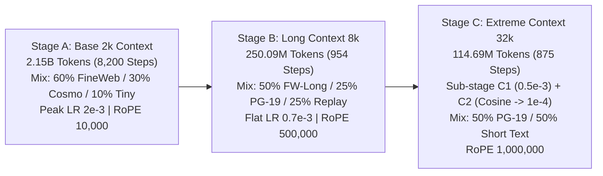

# TinyLLM-42M-32k (Stage C Decayed)

TinyLLM-42M-32k is an ultra-compact, high-efficiency 42.28-million parameter causal language model trained natively on a 3-stage curriculum to support up to **32,768 (32k) tokens of context** with Multi-Query Attention (MQA, 1 KV head).

The model achieves sustained single-stream decode throughput exceeding **1,068–1,176 tokens/sec** at 32k context depth, and scales up to **16,077 aggregate tokens/sec** under high-concurrency batch serving on consumer hardware, with an KV-cache footprint of only **1.5 KB per token**.

---

## Model Architecture

| Parameter | Value | Details |
| :--- | :--- | :--- |
| **Total Parameters** | 42,284,544 (42.28M) | All active parameters |
| **Non-Embedding Parameters** | 35,993,088 (35.99M) | Excludes tied input/output vocabulary |
| **Layers** | 6 | Decoder transformer blocks |
| **Hidden Size ($d_{\text{model}}$)** | 768 | Internal representation dimension |
| **Intermediate Size** | 2,048 | SwiGLU MLP dimension ($2.67 \times d$) |
| **Attention Heads ($n_{\text{head}}$)** | 12 | Query heads (Head dim $d_k = 64$) |
| **Key-Value Heads ($n_{\text{kv}}$)** | 1 | Multi-Query Attention (MQA) |
| **Vocab Size** | 8,192 | Custom SentencePiece BPE byte-fallback |
| **Tied Embeddings** | Yes | Input and output embeddings share weights |
| **Activation** | SwiGLU | SiLU-gated linear units |
| **Norm Type** | RMSNorm | Pre-normalization with $\epsilon = 10^{-6}$ |
| **Positional Encoding** | RoPE | Rotary position embeddings |
| **RoPE Base ($\theta$)** | 1,000,000 ($10^6$) | Scaled for 32k context extension |
| **Max Position Embeddings** | 32,768 | Native 32k context window |

---

## Multi-Stage Training Pipeline

The model was trained over a 3-stage curriculum spanning **2.514 Billion tokens**:



1. **Stage A (2k Context)**: Pretrained on 2,149.6M tokens (8,200 steps at batch size 128 sequences = 262,144 tokens). Learning rate warmed up to $2.0\times 10^{-3}$ and decayed cosine to $2.0\times 10^{-4}$.
2. **Stage B (8k Context)**: Extended to 8,192 context on 250.09M tokens (954 steps at batch size 32 sequences = 262,144 tokens) with flat LR $0.7\times 10^{-3}$ and RoPE $\theta = 500,000$.
3. **Stage C (32k Context)**: Extended to 32,768 context on 114.69M tokens (875 steps at batch size 4 sequences = 131,072 tokens). Sub-stage C1 trained 437 steps at flat LR $0.5\times 10^{-3}$; Sub-stage C2 annealed cosine over 438 steps down to $1.0\times 10^{-4}$ with 50% short-text replay to arrest catastrophic forgetting. RoPE $\theta = 1,000,000$.

### Training Data Provenance and License Status

| Dataset | Hugging Face ID | Stated License on Card | Synthetic Generator Model | Generator Output Terms & Restrictions |
| :--- | :--- | :--- | :--- | :--- |
| **TinyStories** | `roneneldan/TinyStories` | CDLA-Sharing-1.0 | GPT-3.5 and GPT-4 (OpenAI) | OpenAI Business Terms Sec. 2(c)(iii): Output cannot be used to develop models that compete with OpenAI. CDLA-Sharing requires downstream data modifications to be shared. |
| **Cosmopedia v2** | `HuggingFaceTB/cosmopedia-v2` | ODC-By 1.0 | Mixtral-8x22B-Instruct-v0.1 (Mistral AI) | Apache 2.0 (Permissive; no downstream restrictions on synthetic generations). Attribution required under ODC-By. |
| **FineWeb-Edu** | `HuggingFaceFW/fineweb-edu` | ODC-By 1.0 | Llama-3-70B-Instruct (Scorer / Filter only) | Common Crawl web text curated under ODC-By. Scorer used for quality filtering. Attribution required under ODC-By. |
| **Wikipedia (English)** | `wikimedia/wikipedia` | CC BY-SA 3.0 / 4.0 & GFDL | Human contributors | CC BY-SA 4.0: ShareAlike copyleft applies to material and adaptations. Legal status on model weights is an unsettled question. |
| **PG-19** | `emozilla/pg19` | Public Domain | Historical human authors | Project Gutenberg public domain texts published prior to 1919. |

*Model License*: `[Model License: To be determined by model author]`

---

## Evaluation Results

### 1. Matched-Scoring Parity and Quantization Table

Evaluated on exact token sequences matching PyTorch and `llama.cpp` runtime scoring (2,000,000 tokens per 2k evaluation set; 327,680 tokens across 10 held-out 32k windows for PG-19):

| Dataset / Benchmark | Context | PyTorch FP32 | llama.cpp F16 | llama.cpp Q8_0 | llama.cpp Q4_0 | Q8_0 $\Delta$ | Q4_0 $\Delta$ |
| :--- | :---: | :---: | :---: | :---: | :---: | :---: | :---: |
| **Wikipedia Neutral** | 2k | 2.4464 | 2.4464 | 2.4475 | 2.5074 | +0.0011 | +0.0610 |
| **FineWeb-Edu** | 2k | 2.5964 | 2.5964 | 2.5975 | 2.6536 | +0.0010 | +0.0571 |
| **Cosmopedia v2** | 2k | 1.8405 | 1.8405 | 1.8416 | 1.9036 | +0.0010 | +0.0631 |
| **TinyStories** | 2k | 1.3885 | 1.3885 | 1.3894 | 1.4364 | +0.0009 | +0.0479 |
| **PG-19 (10x 32k Windows)** | 32k | 1.9946 | 1.9947 | 1.9963 | 2.0527 | +0.0016 | +0.0581 |

*Scoring Protocol Note on 32k PG-19 numbers*:
- **2.4240 CE**: Full-window scoring from token $0 \dots 32,767$ across 20 held-out 32k windows (655,360 tokens).
- **1.9946 CE**: Scoring across 10 held-out 32k windows (327,680 tokens) via matched scoring.
- **2.3885 CE**: Targeted context-use scoring on the final 1,024 tokens ($[31,744 \dots 32,768]$) across 50 held-out windows.

### 2. Short-Context Regression Audit

Compared against Stage A decayed baseline on identical held-out 2M-token validation sets:

| Dataset | Stage A Decayed | Stage C Decayed | $\Delta$ Loss | Status ($\le +0.05$ threshold) |
| :--- | :---: | :---: | :---: | :---: |
| **FineWeb-Edu** | 2.5611 | 2.5966 | **+0.0355** | **PASS** |
| **Cosmopedia v2** | 1.8351 | 1.8406 | **+0.0055** | **PASS** |
| **TinyStories** | 1.3809 | 1.3887 | **+0.0078** | **PASS** (Replay fully reversed Stage B drift) |
| **Wikipedia Neutral** | 2.6216 | 2.4466 | **-0.1750** | **PASS** (In-domain, trained in Stages B & C) |

### 3. Context Utilization (Paired 95% Confidence Intervals)

Per-window paired difference $d_i = \text{Loss}_{\text{full}} - \text{Loss}_{\text{short}}$ evaluated on the final 1,024 target tokens:

| Dataset | Comparison | Mean $\Delta$ Loss | Std Error | 95% Confidence Interval | Result |
| :--- | :---: | :---: | :---: | :---: | :---: |
| **PG-19 Val** | 8k vs 2k | -0.0412 | 0.0037 | **[-0.0484, -0.0340]** | **PASS** (Clear context benefit) |
| **Wikipedia Long Val** | 8k vs 2k | -0.0196 | 0.0053 | **[-0.0300, -0.0091]** | **PASS** (Clear context benefit) |
| **FineWeb-Edu Long Val** | 8k vs 2k | -0.0361 | 0.0047 | **[-0.0452, -0.0269]** | **PASS** (Clear context benefit) |
| **PG-19 Val** | 32k vs 8k | -0.0173 | 0.0040 | **[-0.0251, -0.0095]** | **PASS** (Clear context benefit) |
| **PG-19 Val** | 32k vs 2k | -0.0538 | 0.0051 | **[-0.0638, -0.0438]** | **PASS** (Significant context benefit) |

---

## Quantization & Deployment Guidance

| Variant | File Size | Recommended Use Case | Characteristics |
| :--- | :---: | :--- | :--- |
| **Q8_0** *(Recommended Default)* | **45.1 MB** | **Single-User / Local Interactive** | Fastest single-stream decode speed (1,176–1,454 tok/s). Virtually zero quality loss ($+0.001$ CE delta). |
| **F16** | **84.8 MB** | **High-Throughput Batched Serving** | Maximum aggregate throughput under heavy batching (**16,077 tokens/sec** at 128 streams). Zero quantization overhead. |
| **Q4_0** | **25.6 MB** | **Edge / Memory-Constrained** | Smallest footprint (25.6 MB). Decode speed ties Q8_0 at 32k context ($1,168 \pm 40$ vs $1,176 \pm 16$ tok/s) with $+0.057$ CE loss penalty. |

---

## Throughput & Inference Benchmarks

All benchmarks measured on **NVIDIA GeForce RTX 3070 Ti Desktop GPU** (8,192 MiB GDDR6X VRAM, 290.00 W Power Limit, Driver 595.97) running `llama.cpp` CUDA backend.

### 1. Single-Stream Decode Speed

Generated tokens: 256 tokens per trial; 10 repetitions with warm-up (`llama-bench -m <gguf> -n 256 -p 0 -ngl 99 -fa 1`).

| Context Depth | F16 Speed (tok/s) | Q8_0 Speed (tok/s) | Q4_0 Speed (tok/s) |
| :---: | :---: | :---: | :---: |
| **0k** | $1389.3 \pm 12.5$ | $1453.6 \pm 73.7$ | **$1566.2 \pm 18.4$** |
| **8k** | $1277.5 \pm 7.0$ | $1348.1 \pm 24.1$ | **$1377.8 \pm 25.6$** |
| **16k** | $1232.1 \pm 12.7$ | $1287.6 \pm 11.2$ | **$1304.7 \pm 18.2$** |
| **32k** | $1068.4 \pm 37.3$ | **$1176.2 \pm 15.9$** | $1168.4 \pm 39.9$ |

### 2. High-Concurrency Batched Throughput (`llama-batched-bench`)

| Quant | Workload / Context | Concurrency | Prompt Speed (t/s) | Aggregate Gen (t/s) | Per-Stream (t/s) | Total VRAM | Free VRAM (8GB GPU) |
| :--- | :--- | :---: | :---: | :---: | :---: | :---: | :---: |
| **Q8_0** | Short (128p / 256g) | 1 | 11,670 | 1,358 | 1,358 | 1.0 GB | 7.0 GB |
| **Q8_0** | Short (128p / 256g) | 8 | 70,055 | 6,685 | 836 | 1.0 GB | 7.0 GB |
| **Q8_0** | Short (128p / 256g) | 32 | 107,755 | 11,107 | 347 | 1.0 GB | 7.0 GB |
| **Q8_0** | Short (128p / 256g) | 64 | 112,909 | 12,521 | 196 | 1.0 GB | 7.0 GB |
| **Q8_0** | Short (128p / 256g) | **128** | 121,421 | **14,915** | 117 | 1.0 GB | 7.0 GB |
| **Q8_0** | Short (128p / 256g) | 256 | 124,642 | 14,164 | 55 | 1.0 GB | 7.0 GB |
| **F16** | Short (128p / 256g) | **128** | 96,117 | **16,077** | 126 | 1.1 GB | 6.9 GB |
| **Q8_0** | Context 2k (2048p / 256g) | 64 | 154,245 | **10,730** | 168 | 1.0 GB | 7.0 GB |
| **Q8_0** | Context 8k (8192p / 256g) | 32 | 121,910 | **6,597** | 206 | 1.0 GB | 7.0 GB |
| **Q8_0** | Context 32k (32768p / 256g) | 16 | 61,284 | **3,602** | 225 | 1.0 GB | 7.0 GB |
| **Q4_0** | Context 32k (32768p / 256g) | 16 | 60,543 | **3,671** | 229 | 1.1 GB | 6.9 GB |

*KV Cache Footprint*: With 1 Key-Value head ($d_k=64$, 6 layers, 16-bit cache), KV cache memory is precisely:
$$\text{KV Cache} = 2 \times 6 \times 1 \times 64 \times 2 \text{ bytes} = 1,536 \text{ bytes/token} = 1.5 \text{ KB/token}$$
At 32k context depth, a full sequence consumes only **48.0 MB** of KV cache. 16 parallel 32k streams consume only **768 MB** of cache.

---

## Honest Limitations & Transparent Disclosures

1. **Parameter Scale (42.28M)**: This is a tiny exploratory model designed for latency, extreme context experimentation, and local embedded inference. It cannot perform reliable factual recall, multi-step formal reasoning, or complex coding tasks. Outputs should be treated as synthetic generation.
2. **Position Stability at 32k**:
   - In a preliminary 10-window sample, PG-19 test loss in the $[16\text{k}-32\text{k}]$ bucket ($2.5985$) minus the $[2\text{k}-4\text{k}]$ reference bucket ($2.5388$) was **$+0.0597$ CE**.
   - In a comprehensive evaluation over 50 stratified windows across the entire held-out PG-19 set, $[16\text{k}-32\text{k}]$ average loss was $2.4054 \pm 0.0651$ CE (paired diff vs $[2\text{k}-4\text{k}]$: **$-0.1803 \pm 0.0605$ CE**, 95% CI: $[-0.2988, -0.0617]$), with 24.0% of individual windows exceeding $+0.05$ CE.
   - Long Wikipedia and FineWeb-Edu up to 8k strictly pass on average ($-0.0237$ CE and $+0.0217$ CE vs $[2\text{k}-4\text{k}]$).
3. **Retrieval Capabilities**:
   - Under 1-of-21 forced candidate passkey ranking, the model achieves **100% Rank-1 accuracy at 2k context**, **95% at 4k**, and **85% at 8k** under natural prose.
   - Under unconstrained full-vocabulary token generation, greedy passkey retrieval falls to 0% as the base model emits natural prose continuations. Explicit needle retrieval at long context without fine-tuning is **unverified**.

---

## How to Run

### 1. HuggingFace Transformers (Python)

```python
import torch
from transformers import AutoModelForCausalLM, AutoTokenizer

model_id = "release/hf"

tokenizer = AutoTokenizer.from_pretrained(model_id)
model = AutoModelForCausalLM.from_pretrained(
    model_id,
    torch_dtype=torch.bfloat16,
    device_map="auto"
)

prompt = "The fundamental difference between planets and stars is "
inputs = tokenizer(prompt, return_tensors="pt").to(model.device)

with torch.no_grad():
    outputs = model.generate(
        **inputs,
        max_new_tokens=64,
        do_sample=True,
        temperature=0.7,
        top_p=0.9
    )

print(tokenizer.decode(outputs[0], skip_special_tokens=True))
```

### 2. llama.cpp CLI

```bash
# Interactive generation with 32k context on Q8_0
./llama-cli -m release/gguf/stageC_q8_0.gguf -p "In ancient history, the Great Pyramid of Giza was built " -n 128 -c 32768 -ngl 99

# High-efficiency server mode
./llama-server -m release/gguf/stageC_q8_0.gguf -c 32768 -ngl 99 --port 8080
```
